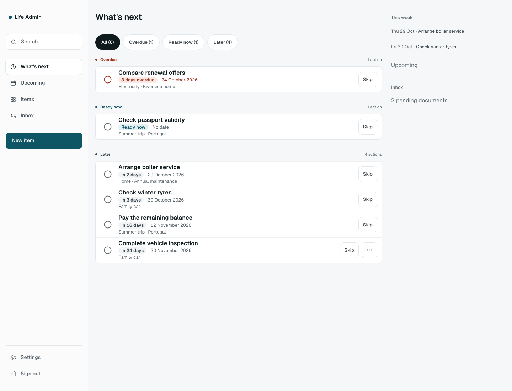
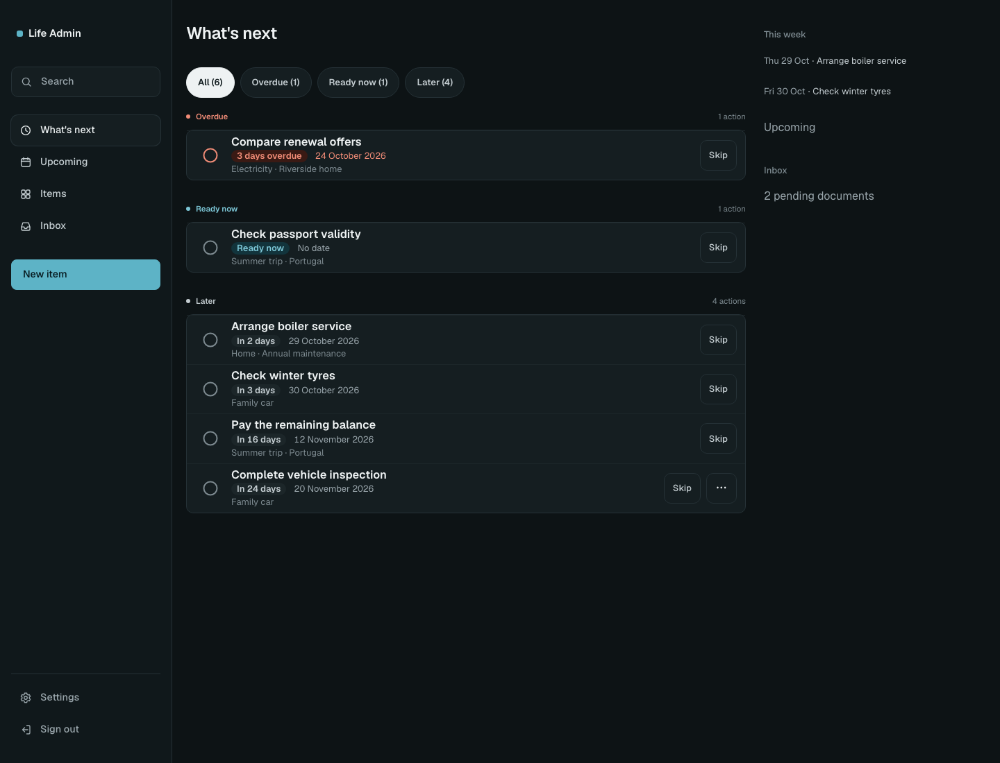
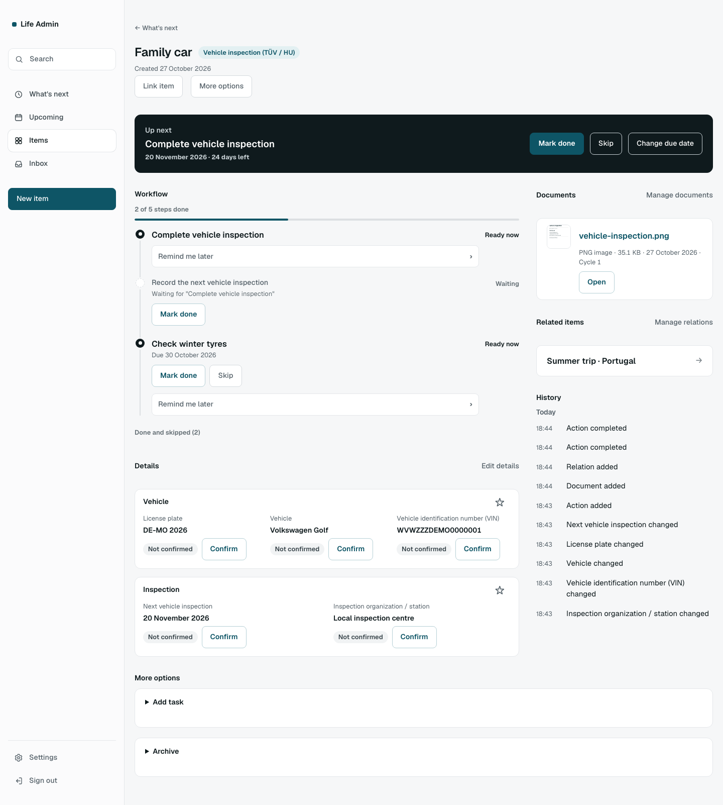
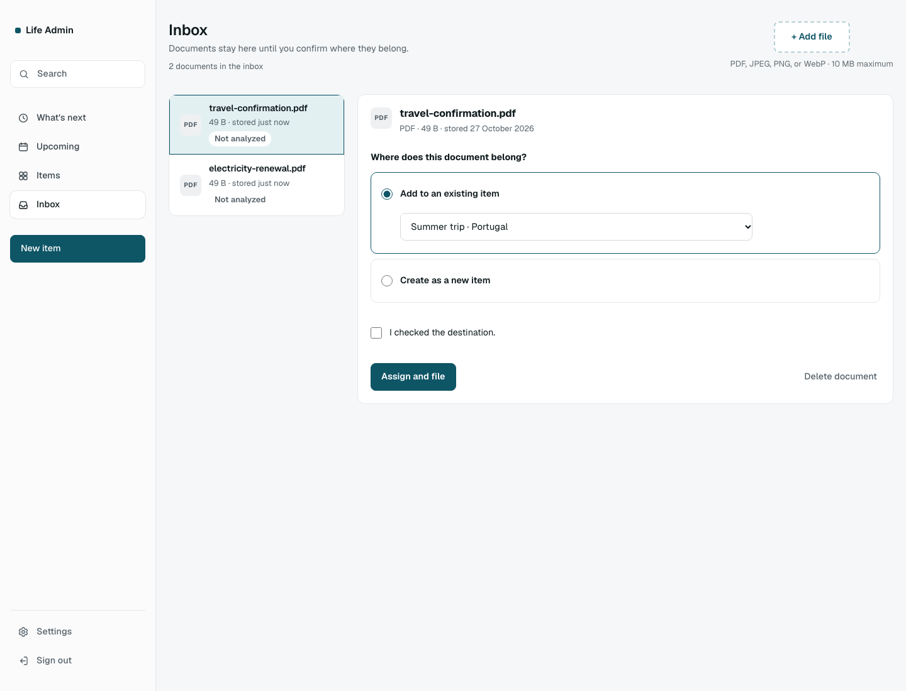
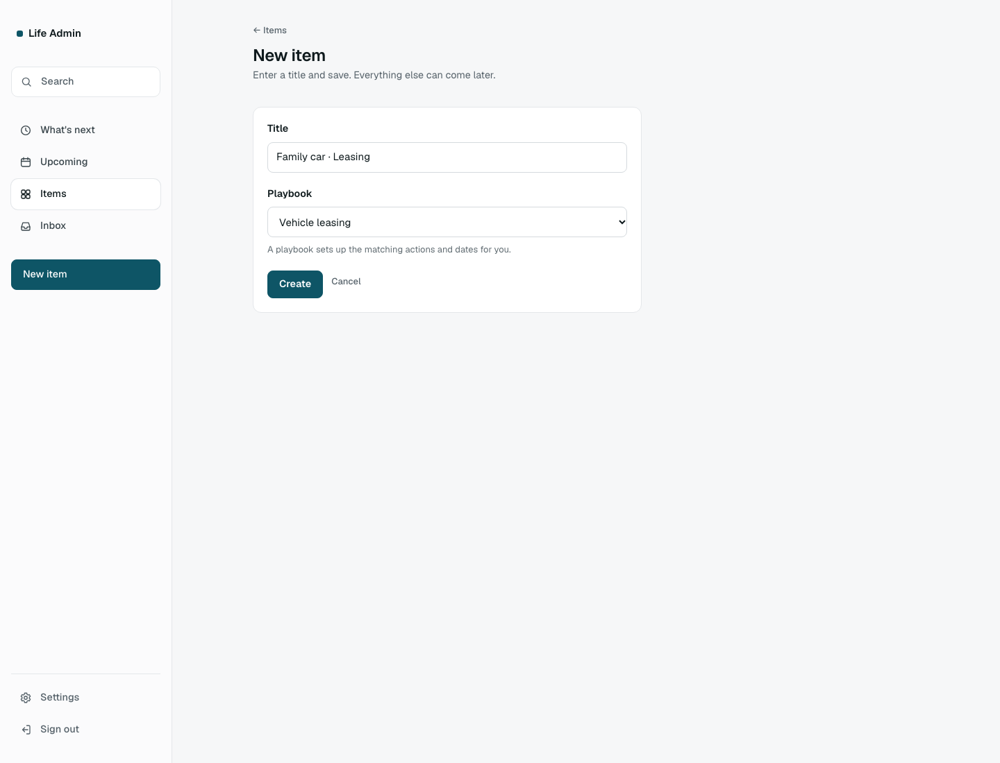
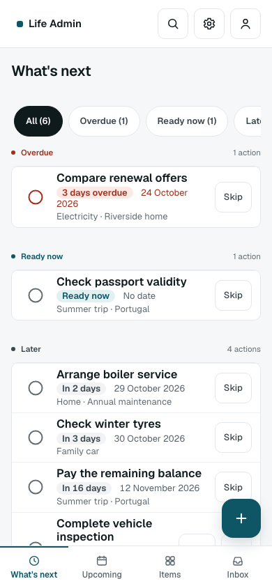

# Life Admin

Self-hosted app that tracks the recurring administrative stuff you can't
afford to forget: vehicle inspections, leasing and electricity contracts,
certificates, expiring documents. For anyone who wants this on their own
server, not in someone else's cloud.

**Status:** beta, active development. **License:** source-available, free
for non-commercial use ([details below](#license)). **Contributing:** see
[CONTRIBUTING.md](CONTRIBUTING.md).

## Screenshots








All data shown is fictional test data, not a real booking or contract.

## Contents

- [Quickstart](#quickstart)
- [Features](#features)
- [Key concepts](#key-concepts)
- [Also useful beyond the household](#also-useful-beyond-the-household)
- [Configuration](#configuration)
- [Backup and restore](#backup-and-restore)
- [Security](#security)
- [Support](#support)
- [Releases](#releases)
- [Local development](#local-development)
- [License](#license)

## Quickstart

```bash
docker compose up -d
```

Requires Docker and Docker Compose. One container, port 3000, all data in
a named volume. Open `http://localhost:3000` and create the Owner
account: the first person to reach the service claims it, so don't leave
it open on a public network before that.

The sample Compose file publishes port 3000 on all host interfaces. Keep
that port behind a firewall on a trusted LAN. For access from the internet,
use HTTPS through a reverse proxy and block direct access to port 3000.

Over plain HTTP, any hostname or port works without extra settings
(`http://192.168.1.20:3000`, `http://nas.local:3000`). Behind a reverse
proxy, see [Access and HTTPS](#access-and-https).

## Features

- Items with recommended fields, dates, and actions, driven by Playbooks
- Bundled Playbooks: vehicle inspection (TÜV), electricity contract,
  leasing, non-assessment certificate, home maintenance, travel booking
- Custom Playbooks, paste or upload your own YAML
- Recurring Cycles with read-only history of past cycles
- Document attachments (PDF, JPEG, PNG, WebP)
- Inbox: upload first, decide which Item it belongs to later
- Global search across Items
- Related Items and an Item overview page
- Human-readable change history per Item
- Backup and restore as a single ZIP archive
- Optional AI-assisted document field extraction (off by default)
- Optional notifications via ntfy or Slack (off by default)

On screens at least 768px wide, the sidebar links to What's Next, Upcoming,
Items and Inbox. Search, New Item, Settings and Sign out are also in the sidebar.
On smaller screens, four bottom tabs provide navigation. Search and Settings
are in the header. The account menu contains Sign out. The floating plus opens
New Item and is hidden on the new-item form. Navigation and sign out work
without JavaScript.

## Key concepts

- **Item**: the thing you're tracking. Example: "NV-Bescheinigung Max",
  "Electricity House", "Mallorca Trip".
- **Playbook**: a YAML file describing an Item's recommended fields,
  dates ("Events"), and actions with relative due dates ("2 months
  before certificate expiry"). Creating an Item from a Playbook freezes
  that Playbook into the Item: later Playbook edits never touch existing
  Items. Only the title is required; everything else can wait.
- **Group**: a named collection of an Item's fields on the Item page. A
  Playbook can set the starting groups. After that the Item owns them: you
  can add and rename groups, move fields, and feature a group to show it
  first. Fields without a group (including ones you add yourself) are in
  General. Empty fields are hidden and counted, and stay editable.

Every action belongs to an Item. There's no flat, anonymous to-do list.

### Organize an Item

The next action has complete and skip controls in its card, on phones and desktop.
The workflow lists open steps first. Expand **Done and skipped** to see their
dates or reopen a step. Scheduling stays in the action's secondary controls.

Under **Details**, open **Edit details**, then **Manage groups** to create or
rename groups, move fields, feature groups or change their order. Featured
groups appear first. Group names, order and assignments stay with the Item
when you start a new cycle; field values still follow the Playbook's reset rules.
Empty fields remain available in the edit form. Archived Items are read-only.

Each value shows whether you confirmed it. A value starts as **Not confirmed**,
also when a document suggestion filled it. Use **Confirm** to mark it, and
**Withdraw confirmation** to undo that. Every field has its own state, so a
date and a time are confirmed separately. Changing a value resets only that
field's confirmation. A value you save unchanged keeps it. A field without a
value cannot be confirmed. A time such as `12:30` is stored as written. It is
a local time and is never converted to another timezone. Dates follow the
selected language. If a document suggestion came with a short excerpt, the
value shows it as **Source**. Manual and older values have no source line.

Documents, related Items and history follow the fields. Document suggestions
show their source in history when available. Older events keep generic text.
History dates and older upload dates use local calendar days, including across
daylight saving time changes.
Add-task and archive controls are under **More options** at the bottom.

## Also useful beyond the household

The examples above are private households, but Items and Playbooks fit
anyone tracking recurring deadlines tied to a specific thing:

- **Landlords**: one Item per rental unit, tracking lease renewal dates,
  deposit deadlines, mandatory safety inspections, and insurance renewals.
- **Tradespeople**: one Item per client job or company vehicle, tracking
  warranty periods, follow-up visits, vehicle inspections, and
  certification renewals.
- **Small businesses**: one Item per contract, licence, or piece of
  equipment that needs periodic renewal or inspection.

None of this needs a bundled Playbook: write a [custom
one](#custom-playbooks), or start with a generic Item and add fields and
actions as you go.

## Configuration

### Access and HTTPS

Plain HTTP sends the password and session cookie unencrypted, so only
use it on a trusted home network. For HTTPS, put a reverse proxy in front.
If the proxy runs on the same host, change the Compose port mapping to
`127.0.0.1:3000:3000` so clients cannot bypass the proxy. Set `ORIGIN` to
the public HTTPS URL. Do not expose the default HTTP mapping to the internet.

The image contains no origin, so the same image works at any hostname.
Form submissions are checked against the origin of the request. The
server picks it like this:

1. **`ORIGIN` set** (for example `ORIGIN=https://life-admin.example.com`):
   this is the only accepted origin. It must be `scheme://host[:port]`
   with `http` or `https`, and no path. Any other value stops the server
   at startup. This is the safest choice behind a proxy.
2. **`PROTOCOL_HEADER` / `HOST_HEADER` / `PORT_HEADER` set**
   (for example `x-forwarded-proto` and `x-forwarded-host`): the origin
   is read from these headers. Only enable this if a reverse proxy in
   front of Life Admin overwrites these headers on every request and
   nobody can reach port 3000 directly. Otherwise a client can forge
   them. Set `LIFEADMIN_COOKIE_SECURE=true` if the proxy serves HTTPS and
   you do not set `ORIGIN`.
3. **Nothing set** (direct access): the origin is `http://` plus the
   `Host` header. `X-Forwarded-*` headers are ignored.

If `ORIGIN` is set, it wins over the header settings. The Secure cookie
flag turns on by itself when `ORIGIN` starts with `https://`
(`LIFEADMIN_COOKIE_SECURE` can override it). Cross-site form submissions
are rejected in every mode.

Forgot the password? Set `LIFEADMIN_RESET_OWNER_PASSWORD`, restart, sign
in, then remove the variable and restart again.

### Bundled playbooks

| Id                          | What it tracks                            |
| --------------------------- | ----------------------------------------- |
| `de.vehicle.tuv`            | vehicle inspection (TÜV)                  |
| `de.finance.nv-certificate` | non-assessment certificate                |
| `de.contract.electricity`   | electricity contract                      |
| `de.vehicle.leasing`        | vehicle leasing contract                  |
| `de.home.maintenance`       | recurring maintenance or inspection       |
| `de.travel.booking`         | dates, payments, and deadlines for a trip |

### Custom playbooks

Add one under Settings, Playbooks: paste YAML or upload a `.yaml` file.
It's validated before storing, then available for new Items right away.
Replacing or removing a Playbook never touches existing Items.

See ["Authoring Playbooks" in CONTRIBUTING.md](CONTRIBUTING.md#authoring-playbooks)
for the schema, the validation command, and a worked example. Advanced
users can also drop `.yaml` files under `/data/playbooks` in the
container volume; invalid files are skipped and reported in Settings.

### Attachments and Inbox

Attach documents to Items directly (PDF, JPEG, PNG, WebP, up to 10 MB
each), stored under `/data/attachments` and included in backups. Or
upload to the Inbox first and route it to an existing or new Item later;
Inbox documents stay private and are included in backups until routed
or deleted.

### AI document extraction (optional)

Off by default. Needs an OpenAI API key and an explicit consent toggle
in `/settings`. Once on, attachments get an "Informationen erkennen"
button that returns a reviewable list of suggested field values and
suggested tasks. Nothing writes to the Item until you submit. New values
are pre-selected, a value that differs from the current one keeps the
current value unless you explicitly choose the document value, and no
task is created unless you select it.
New additional details can be assigned to an existing Item group before
acceptance. Items with one group use General automatically. Label, type and
value edits are available under “Edit details”.

```
LIFEADMIN_OPENAI_API_KEY=sk-...
# LIFEADMIN_AI_MODEL=gpt-5.6-terra   # operator override only, see .env.example
```

Under Docker Compose, copy `.env.example` to `.env`, fill in the key,
uncomment `env_file: .env` in `compose.yaml`, then `docker compose up -d`
again (`compose.yaml` ignores `.env.example` itself).

Each suggested value may come with a short excerpt of the document (at most
300 characters). It is shown during review and stored with the value only when
you accept the suggestion unchanged. Longer excerpts are dropped.

Only the selected document's bytes, its MIME type, the current
cycle's field labels, and the titles of the Item's existing tasks (to
avoid duplicate suggestions) get sent, never the Item title, notes,
other attachments, or existing values. The key never touches the database or
a backup; a restored backup on a new machine needs the env var set
again, same as `ORIGIN`.

### Notifications (optional)

Off by default. Pick one channel in Settings: an ntfy server/topic or a
Slack Incoming Webhook. One reminder shortly before something is due,
one when it's overdue. Nothing goes out for undated, blocked, completed,
archived, or unresolved work. Reminders go out at or after a local time of
day you set in Settings (default 08:00, whole minutes). It is the
notification time, not a due time. Tokens stay local and are excluded from
backups, so re-enter them after restoring elsewhere.

## Backup and restore

Download a ZIP backup from Settings: all your private data, including
attachments, capped at 256 MiB compressed. Restore validates the archive
and takes a safety copy first. Afterward, run
`docker compose restart lifeadmin`.

For a full volume copy, stop the service, run
`docker cp lifeadmin:/data ./backup`, then start it again. Pre-restore
safety copies can be pulled without stopping:
`docker cp lifeadmin:/data/backups ./`.

## Security

- Self-hosted: your data never leaves your server unless you turn on
  optional AI extraction or notifications, and even then only the
  specific document or reminder text goes out, never your full database.
- Backups exclude stored secrets (AI provider keys, notification
  tokens) by design.
- Plain HTTP is unencrypted in transit; use it only on a trusted network,
  or put HTTPS in front (see [Configuration](#configuration)).
- No telemetry, no analytics, no phoning home.
- Found a vulnerability? Use GitHub's private vulnerability reporting for
  this repository instead of a public issue. See [SECURITY.md](SECURITY.md).

## Support

- Bug or question: open a GitHub issue.
- Security vulnerability: see [SECURITY.md](SECURITY.md), don't use a
  public issue.
- Something not working after setup: check
  [Access and HTTPS](#access-and-https) first. Behind a reverse proxy,
  a wrong or missing `ORIGIN` or proxy header setting is the most common
  cause of failed form submissions (403).

## Releases

Life Admin follows a build-once, promote-after-validation release process.
Release candidates are deployed to a private staging environment and validated
before the exact same artifact is promoted to an official GHCR image and
GitHub Release.

See [docs/releasing.md](docs/releasing.md) for the full release runbook,
quality gates, and versioning details.

## Local development

Requires Node.js 24.

```bash
npm install
npm run dev
```

```bash
npm run verify   # lint, typecheck, playbook validation, unit tests, build
npm run test:e2e # Playwright end-to-end tests (builds first)
```

See [CONTRIBUTING.md](CONTRIBUTING.md) for the full workflow.

## License

Source-available. Free to use, modify, and self-host under the PolyForm
Noncommercial License 1.0.0. Commercial use needs a separate commercial
license.

- [`LICENSE`](LICENSE)
- [`COMMERCIAL-LICENSE.md`](COMMERCIAL-LICENSE.md)
